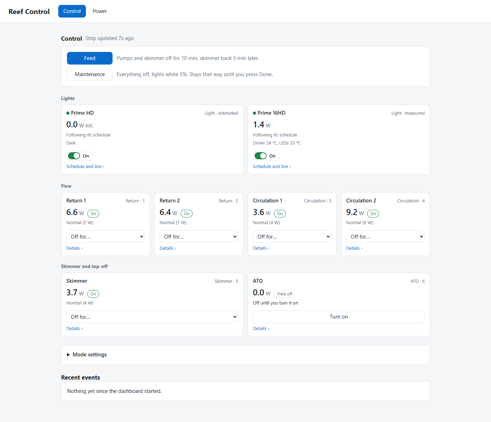

# Reef Control

Reef Control is a dashboard for my reef tank's lights and power that runs on the PC
next to it. It uses no cloud accounts or vendor apps. Every schedule it writes is backed up
first and read back to check it, and the tank keeps running when the PC is off.



## Hardware

| Device | Connection | Library |
|---|---|---|
| AI Prime HD light | Wi-Fi, the light's local HTTP API | `httpx` |
| AI Prime 16HD light | Bluetooth LE | `python-mobius` |
| TP-Link Tapo P316M power strip (6 outlets) | Wi-Fi, local KLAP login | `python-kasa` 0.12.0 |

The P316M has no Wi-Fi setup network, so it was put on Wi-Fi over Matter from the PC with
the matter.js shell in `tools/matter/` (setup only, not part of the running dashboard). No
TP-Link app or account was used.

## What it does

- Edits one light schedule shared by both lights, with per-light tweaks, and sends it to each light.
- Live control of the lights, held until "Back to schedule". Lights on/off.
- Switches the six outlets, with roles for return pumps, circulation, skimmer and ATO.
- Feed mode (pumps off for a set time) and maintenance mode. After feeding, the skimmer comes back on after a delay.
- Shows power use per outlet and watches the ATO pump for runs that are too long or too frequent.

## Safety design

- **The tank doesn't depend on the PC.** The lights keep their schedules on the lights. The
  strip keeps its outlets on, and timers like "pumps back on in 10 minutes" are stored on
  the strip and run there. Each outlet has a set state for after a power cut. The dashboard
  edits and monitors; the tank is fine when it isn't running.
- **Every write is backed up and read back.** Before writing a schedule, the current one is
  saved to `backups/`. After writing, it is read back from the device and compared. Any
  earlier schedule can be loaded from the history page and sent again.
- **Local only.** No accounts, no vendor apps, no remote access. The page is served on
  `localhost` only.

## Setup

Windows, Python 3.11.

```powershell
pip install -r requirements.txt
Copy-Item config.example.toml config.toml
```

Fill in `config.toml` with your lights' and strip's addresses and the 16HD's serial. Reserve
the addresses in your router. `config.toml` is not tracked by git.

## Running

```powershell
.\run.ps1
```

This starts the server and opens `http://localhost:8000`. `.\install-startup.ps1` instead
sets it to start in the notification area when you sign in, and adds a Start menu shortcut
(`.\install-startup.ps1 -Remove` undoes this).

Tests use fake devices and don't touch hardware:

```powershell
python -m unittest discover -s tests -t .
```

## License

MIT, see [LICENSE](LICENSE). This covers the code in this repository only. It depends on
python-kasa (GPL-3.0-or-later), python-mobius (GPL-2.0-only), pystray (LGPL-3.0) and
matter.js (Apache-2.0), which are installed separately and not included here. Don't
distribute a bundled build (for example a PyInstaller executable): GPL-2.0-only and
GPL-3.0 code can't be combined in one distributed program.
